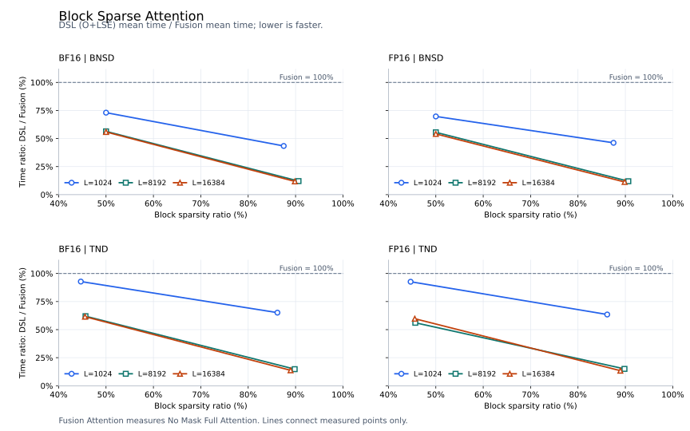

# Block Sparse Attention

## 功能说明

按预选 KV 块计算的非因果稀疏注意力前向。每个 query block 通过 `block_indices` 指定可见的 KV blocks，仅在这些块的有效 token 上计算：

```text
scores = (Q @ selected_K.T) * softmax_scale
output = softmax(scores) @ selected_V
```

softmax 在该 query 行的全部已选 KV token 上归一化。支持 FP16/BF16、定长 BNSD、变长 packed TND、非 128 对齐的 Q/K 尾块，以及 MHA/GQA/MQA。GQA 的 KV head 为 `query_head // (QH // KVH)`；稀疏索引可以在所有 query heads 间共享，也可以逐 query head 指定。

## 参数说明

```python
output = block_sparse_attention(
    q, k, v, block_indices, block_shape,
    cu_seqlens_q=None, cu_seqlens_k=None,
    max_seqlen_q=None, max_seqlen_k=None,
    softmax_scale=None, is_causal=False, return_lse=False,
)
```

记 `B` 为 batch 数，`QH/KVH` 为 query/KV head 数，`Sq/Sk` 为定长 Q/K 长度，`Tq/Tk` 为 packed 总 token 数，`Ksel` 为每个 query block 选择的 KV block 数。`Nq = ceil(Sq/128)`；变长模式下为 `ceil(max_seqlen_q/128)`。

| 参数 | 类型 / shape | 说明 |
| --- | --- | --- |
| `q` | FP16/BF16 Tensor；定长 `[B,QH,Sq,128]`，变长 `[Tq,QH,128]` | 连续 BNSD 或 TND 张量；入口根据 Q 的 rank 选择模式 |
| `k` | 与 Q 同 dtype；定长 `[B,KVH,Sk,128]`，变长 `[Tk,KVH,128]` | 连续张量，与 Q 位于同一 NPU |
| `v` | 与 K 同 shape、dtype、device | value dimension 同样固定为 128 |
| `block_indices` | 连续 INT32 Tensor；`[B,Nq,Ksel]` 或 `[B,MH,Nq,Ksel]` | 与 Q 位于同一 NPU；`MH=1` 表示共享，`MH=QH` 表示逐头。每项为当前序列内从 0 开始的 KV block 编号 |
| `block_shape` | INT64 Tensor，shape `[2]`，值 `[128,128]` | 分别指定 Q/KV 块大小；当前实现固定为 128×128 |
| `cu_seqlens_q` | 连续 INT32 Tensor，shape `[B+1]` | 变长模式必填，与 Q 位于同一 NPU；Q 的累计 token 边界，包含首项 0 和末项 `Tq` |
| `cu_seqlens_k` | 连续 INT32 Tensor，shape `[B+1]` | 变长模式必填，与 Q 位于同一 NPU；K/V 共用的累计边界，包含首项 0 和末项 `Tk` |
| `max_seqlen_q` | Python 整数，默认 `None` | 变长模式必填，至少覆盖每条实际 Q 长度，并决定索引的 `Nq` 维；定长模式不使用 |
| `max_seqlen_k` | Python 整数，默认 `None` | 变长模式必填，至少覆盖每条实际 KV 长度；定长模式不使用 |
| `softmax_scale` | Python 浮点数或 `None` | score 乘数，默认 `128**-0.5` |
| `is_causal` | bool，默认 `False` | 当前仅支持 `False` |
| `return_lse` | bool，默认 `False` | 为 `True` 时返回 `(output, softmax_lse)`；LSE 为连续 FP32 Tensor，定长 `[B,QH,Sq,1]`，变长 `[Tq,QH,1]` |

定长输入不使用累计边界和最大长度参数。变长输入将各序列沿 token 维拼接，Q/K 的实际长度可以不同。`block_indices[b,...]` 中的 KV block 编号相对于第 b 条 KV 序列的起点。

## 约束说明

- head dimension 与块大小均固定为 128，且 `QH % KVH == 0`。
- `block_indices` 每个有效行内的 KV block 编号必须互不重复，并满足 `0 <= index < ceil(该序列实际 KV 长度/128)`。

## 性能结果

### 测量配置与口径

- 设备：Ascend950PR；每个实现每个用例采样 3 次，输入随机种子为 1。
- 形状：`QH=KVH=8`、`D=128`、block=128×128。定长 B=1，变长 B=2，稀疏索引在 query heads 间共享。
- 对照：Fusion Attention 计算的是 **No Mask 的 Full Attention 耗时**，接口为 `torch_npu.npu_fusion_attention`，`atten_mask=None`、`sparse_mode=0`、`keep_prob=1.0`、`inner_precise=0`，scale 与 DSL 相同。
- 计时：使用 `torch_npu.profiler` 的 Computing 指标，取 3 次平均。计时不包含输入准备、布局参数转换和 host 编译时间。
- 加速比为 `Fusion 平均耗时 / DSL 平均耗时`。对照计算稠密注意力，本算子计算稀疏注意力，因此加速比包含计算量减少的收益。

36 个配置的加速比范围为 **1.285–8.457×**，几何平均为 **2.862×**。

### 相对耗时折线图

横轴为块稀疏率，纵轴为 `DSL 平均耗时 / Fusion Attention 平均耗时`，以百分比表示；100% 表示与 Fusion Attention 耗时相同，数值越低表示耗时越短。每条曲线对应一种序列长度，图例中的 `L` 在定长图中表示序列长度，在变长图中表示最大序列长度。分母为 Fusion Attention 的 No Mask Full Attention 耗时。



### 逐用例平均耗时

耗时单位为 μs。定长配置的 Q/K 长度相同；变长配置如下，各长度元组按 batch 顺序排列。

| 变长配置 | `max_seqlen_q/k` | 实际 Q 长度 | 实际 K/V 长度 |
| --- | ---: | --- | --- |
| TND-1K | 1024 | (1023, 513) | (1001, 641) |
| TND-8K | 8192 | (8191, 4097) | (8129, 6145) |
| TND-16K | 16384 | (16383, 8193) | (16257, 12289) |

| 配置 | dtype | 标称稀疏率 | 块稀疏率 | Fusion（μs） | DSL（μs） | 加速比 |
| --- | --- | ---: | ---: | ---: | ---: | ---: |
| BNSD-1024 | FP16 | 50% | 50.0000% | 24.971 | 17.404 | 1.435× |
| BNSD-1024 | FP16 | 90% | 87.5000% | 25.117 | 11.605 | 2.164× |
| BNSD-8192 | FP16 | 50% | 50.0000% | 813.715 | 451.934 | 1.801× |
| BNSD-8192 | FP16 | 90% | 90.6250% | 803.358 | 96.126 | 8.357× |
| BNSD-16384 | FP16 | 50% | 50.0000% | 3299.978 | 1786.064 | 1.848× |
| BNSD-16384 | FP16 | 90% | 89.8438% | 3251.988 | 367.430 | 8.851× |
| BNSD-1024 | BF16 | 50% | 50.0000% | 24.854 | 18.159 | 1.369× |
| BNSD-1024 | BF16 | 90% | 87.5000% | 24.745 | 10.738 | 2.304× |
| BNSD-8192 | BF16 | 50% | 50.0000% | 803.030 | 453.008 | 1.773× |
| BNSD-8192 | BF16 | 90% | 90.6250% | 802.303 | 97.068 | 8.265× |
| BNSD-16384 | BF16 | 50% | 50.0000% | 3106.737 | 1735.290 | 1.790× |
| BNSD-16384 | BF16 | 90% | 89.8438% | 3113.894 | 368.161 | 8.458× |
| BNSD-1023 | FP16 | 50% | 50.0000% | 25.001 | 18.443 | 1.356× |
| BNSD-1023 | FP16 | 90% | 87.5000% | 24.726 | 10.263 | 2.409× |
| BNSD-8191 | FP16 | 50% | 50.0000% | 802.685 | 462.865 | 1.734× |
| BNSD-8191 | FP16 | 90% | 90.6250% | 817.899 | 95.451 | 8.569× |
| BNSD-16383 | FP16 | 50% | 50.0000% | 3430.628 | 1760.304 | 1.949× |
| BNSD-16383 | FP16 | 90% | 89.8438% | 3247.608 | 369.089 | 8.799× |
| BNSD-1023 | BF16 | 50% | 50.0000% | 25.170 | 18.201 | 1.383× |
| BNSD-1023 | BF16 | 90% | 87.5000% | 24.886 | 11.952 | 2.082× |
| BNSD-8191 | BF16 | 50% | 50.0000% | 802.445 | 453.879 | 1.768× |
| BNSD-8191 | BF16 | 90% | 90.6250% | 802.017 | 95.134 | 8.430× |
| BNSD-16383 | BF16 | 50% | 50.0000% | 3130.631 | 1734.974 | 1.804× |
| BNSD-16383 | BF16 | 90% | 89.8438% | 3166.364 | 367.839 | 8.608× |
| TND-1K | FP16 | 50% | 44.6809% | 29.915 | 27.719 | 1.079× |
| TND-1K | FP16 | 90% | 86.1702% | 30.295 | 19.228 | 1.576× |
| TND-8K | FP16 | 50% | 45.6678% | 1221.196 | 685.038 | 1.783× |
| TND-8K | FP16 | 90% | 89.8127% | 1106.356 | 166.188 | 6.657× |
| TND-16K | FP16 | 50% | 45.5595% | 4448.557 | 2656.268 | 1.675× |
| TND-16K | FP16 | 90% | 88.9418% | 4312.371 | 578.864 | 7.450× |
| TND-1K | BF16 | 50% | 44.6809% | 30.277 | 28.104 | 1.077× |
| TND-1K | BF16 | 90% | 86.1702% | 29.986 | 19.531 | 1.535× |
| TND-8K | BF16 | 50% | 45.6678% | 1099.849 | 681.627 | 1.614× |
| TND-8K | BF16 | 90% | 89.8127% | 1112.715 | 164.526 | 6.763× |
| TND-16K | BF16 | 50% | 45.5595% | 4272.610 | 2628.652 | 1.625× |
| TND-16K | BF16 | 90% | 88.9418% | 4273.438 | 587.232 | 7.277× |
