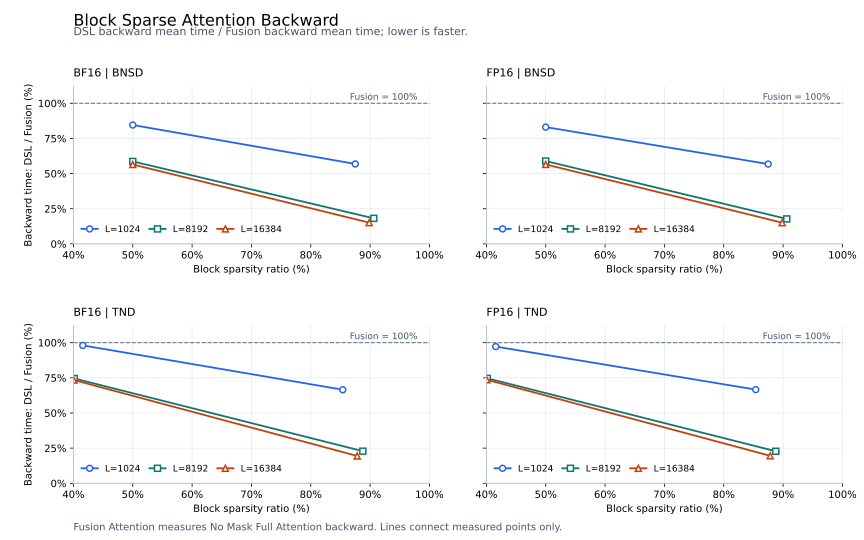

# Block Sparse Attention Backward

## 功能说明

实现非因果块稀疏注意力反向，接收 Q/K/V、输出梯度 `grad_output`、前向输出 `attention_out` 和逐行 `softmax_lse`，计算 `dq`、`dk`、`dv`。每个 query block 通过 `block_indices` 指定参与计算的 KV blocks。

记 `dO = grad_output`、`O = attention_out`、`scale = softmax_scale`，在已选 KV token 上计算：

```text
S  = scale * Q @ K.T
P  = exp(S - softmax_lse)
dP = dO @ V.T
D  = row_sum(dO * O)
dS = P * (dP - D)
dQ = scale * dS @ K
dK = scale * dS.T @ Q
dV = P.T @ dO
```

支持 FP16/BF16、定长 BNSD、变长 packed TND、非 128 对齐的 Q/K 尾块，以及 MHA/GQA/MQA。GQA 的 KV head 为 `query_head // (QH // KVH)`；稀疏索引可以在 query heads 间共享，也可以逐 query head 指定。来自多个 query blocks 或 query heads 的 dK/dV 贡献累加到对应 KV 位置。

## 参数说明

```python
dq, dk, dv = block_sparse_attention_backward(
    q, k, v, grad_output, attention_out, softmax_lse,
    block_indices, block_shape,
    cu_seqlens_q=None, cu_seqlens_k=None,
    max_seqlen_q=None, max_seqlen_k=None,
    softmax_scale=None, is_causal=False,
)
```

记 `B` 为 batch 数，`QH/KVH` 为 query/KV head 数，`Sq/Sk` 为定长 Q/K 长度，`Tq/Tk` 为 packed 总 token 数，`Ksel` 为每个 query block 选择的 KV block 数。`Nq = ceil(Sq/128)`；变长模式下为 `ceil(max_seqlen_q/128)`。

| 参数 | 类型 / shape | 说明 |
| --- | --- | --- |
| `q` | FP16/BF16 Tensor；定长 `[B,QH,Sq,128]`，变长 `[Tq,QH,128]` | 连续 BNSD 或 TND 张量；入口根据 Q 的 rank 选择模式 |
| `k` | 与 Q 同 dtype；定长 `[B,KVH,Sk,128]`，变长 `[Tk,KVH,128]` | 连续张量，与 Q 位于同一 NPU |
| `v` | 与 K 同 shape、dtype、device | value dimension 固定为 128 |
| `grad_output` | 与 Q 同 shape、dtype、device | 前向输出的上游梯度 dO，连续张量 |
| `attention_out` | 与 Q 同 shape、dtype、device | 对应稀疏前向输出 O，连续张量 |
| `softmax_lse` | 连续 FP32 Tensor；定长 `[B,QH,Sq,1]`，变长 `[Tq,QH,1]` | 与 Q 位于同一 NPU；对应稀疏前向每行 score 的自然对数 log-sum-exp |
| `block_indices` | 连续 INT32 Tensor；`[B,Nq,Ksel]` 或 `[B,MH,Nq,Ksel]` | 与 Q 位于同一 NPU；`MH=1` 表示共享，`MH=QH` 表示逐头。每项为当前序列内从 0 开始的 KV block 编号 |
| `block_shape` | INT64 Tensor，shape `[2]`，值 `[128,128]` | Q/KV 块大小，当前实现固定为 128×128 |
| `cu_seqlens_q` | 连续 INT32 Tensor，shape `[B+1]` | 变长模式必填，与 Q 位于同一 NPU；Q 的累计 token 边界，包含首项 0 和末项 `Tq` |
| `cu_seqlens_k` | 连续 INT32 Tensor，shape `[B+1]` | 变长模式必填，与 Q 位于同一 NPU；K/V 共用的累计边界，包含首项 0 和末项 `Tk` |
| `max_seqlen_q` | Python 整数，默认 `None` | 变长模式必填，至少覆盖每条实际 Q 长度，并决定索引的 `Nq` 维；定长模式不使用 |
| `max_seqlen_k` | Python 整数，默认 `None` | 变长模式必填，至少覆盖每条实际 KV 长度；定长模式不使用 |
| `softmax_scale` | Python 浮点数或 `None` | score 乘数，默认 `128**-0.5` |
| `is_causal` | bool，默认 `False` | 当前仅支持 `False` |

返回 `(dq, dk, dv)`，分别与 Q、K、V 的 shape、dtype、device 一致，均为连续 Tensor。

定长输入不使用累计边界和最大长度参数。变长输入将各序列沿 token 维拼接，Q/K 的实际长度可以不同。`block_indices[b,...]` 中的 KV block 编号相对于第 b 条 KV 序列的起点。

## 约束说明

- head dimension 与块大小均固定为 128，且 `QH % KVH == 0`。
- `block_indices` 每个有效行内的 KV block 编号必须互不重复，并满足 `0 <= index < ceil(该序列实际 KV 长度/128)`。
- 不支持确定性计算

## 性能结果

### 测量配置与口径

- 形状：`QH=KVH=8`、`D=128`、block=128×128。定长 B=1，变长 B=2，稀疏索引在 query heads 间共享。
- 对照：Fusion Attention 计算的是 **No Mask 的 Full Attention 反向耗时**，接口为 `torch_npu.npu_fusion_attention_grad`，`atten_mask=None`、`sparse_mode=0`、`keep_prob=1.0`、`inner_precise=0`，scale 与 DSL 相同。
- 计时：使用 `torch_npu.profiler` 的 Computing 指标，取 3 次平均，包含反向调用的全部设备计算。输入准备、前向输出和 softmax 中间量准备、host 编译时间不计入。
- 两侧使用相同的 Q/K/V、`grad_output`、dtype、布局和序列边界。本算子消费传入的稀疏 `attention_out`/`softmax_lse`，Fusion 对照消费自身 Full Attention 前向产生的中间量。
- 加速比为 `Fusion 反向平均耗时 / DSL 反向平均耗时`。对照计算稠密注意力反向，本算子计算稀疏注意力反向，因此加速比包含计算量减少的收益。

36 个配置的加速比范围为 **1.020–6.679×**，几何平均为 **2.297×**。

### 相对耗时折线图

横轴为块稀疏率，纵轴为 `DSL 反向平均耗时 / Fusion Attention 反向平均耗时`，以百分比表示；100% 表示两者耗时相同，数值越低表示耗时越短。每条曲线对应一种序列长度，图例中的 `L` 在定长图中表示序列长度，在变长图中表示最大序列长度。分母为 Fusion Attention 的 No Mask Full Attention 反向耗时。



### 逐用例平均耗时

耗时单位为 μs。定长配置的 Q/K 长度相同；变长配置如下，各长度元组按 batch 顺序排列。

| 变长配置 | `max_seqlen_q/k` | 实际 Q 长度 | 实际 K/V 长度 |
| --- | ---: | --- | --- |
| TND-1K | 1024 | (1023, 513) | (1001, 535) |
| TND-8K | 8192 | (8191, 4097) | (8129, 4159) |
| TND-16K | 16384 | (16383, 8193) | (16257, 8319) |

| 配置 | dtype | 标称稀疏率 | 块稀疏率 | Fusion 反向（μs） | DSL 反向（μs） | 加速比 |
| --- | --- | ---: | ---: | ---: | ---: | ---: |
| BNSD-1024 | FP16 | 50% | 50.0000% | 60.693 | 50.402 | 1.204× |
| BNSD-1024 | FP16 | 90% | 87.5000% | 60.561 | 34.376 | 1.762× |
| BNSD-8192 | FP16 | 50% | 50.0000% | 2237.107 | 1317.662 | 1.698× |
| BNSD-8192 | FP16 | 90% | 90.6250% | 2236.457 | 397.628 | 5.624× |
| BNSD-16384 | FP16 | 50% | 50.0000% | 8441.654 | 4769.733 | 1.770× |
| BNSD-16384 | FP16 | 90% | 89.8438% | 8440.005 | 1272.713 | 6.632× |
| BNSD-1024 | BF16 | 50% | 50.0000% | 59.476 | 50.278 | 1.183× |
| BNSD-1024 | BF16 | 90% | 87.5000% | 60.376 | 34.328 | 1.759× |
| BNSD-8192 | BF16 | 50% | 50.0000% | 2238.676 | 1312.717 | 1.705× |
| BNSD-8192 | BF16 | 90% | 90.6250% | 2236.079 | 406.050 | 5.507× |
| BNSD-16384 | BF16 | 50% | 50.0000% | 8441.519 | 4765.843 | 1.771× |
| BNSD-16384 | BF16 | 90% | 89.8438% | 8446.553 | 1275.585 | 6.622× |
| BNSD-1023 | FP16 | 50% | 50.0000% | 59.194 | 51.421 | 1.151× |
| BNSD-1023 | FP16 | 90% | 87.5000% | 60.086 | 35.051 | 1.714× |
| BNSD-8191 | FP16 | 50% | 50.0000% | 2235.765 | 1332.162 | 1.678× |
| BNSD-8191 | FP16 | 90% | 90.6250% | 2231.736 | 405.167 | 5.508× |
| BNSD-16383 | FP16 | 50% | 50.0000% | 8522.924 | 4803.938 | 1.774× |
| BNSD-16383 | FP16 | 90% | 89.8438% | 8523.870 | 1284.500 | 6.636× |
| BNSD-1023 | BF16 | 50% | 50.0000% | 59.033 | 51.714 | 1.142× |
| BNSD-1023 | BF16 | 90% | 87.5000% | 59.321 | 34.770 | 1.706× |
| BNSD-8191 | BF16 | 50% | 50.0000% | 2237.457 | 1331.161 | 1.681× |
| BNSD-8191 | BF16 | 90% | 90.6250% | 2233.851 | 404.423 | 5.524× |
| BNSD-16383 | BF16 | 50% | 50.0000% | 8525.724 | 4807.708 | 1.773× |
| BNSD-16383 | BF16 | 90% | 89.8438% | 8520.863 | 1275.854 | 6.679× |
| TND-1K | FP16 | 50% | 41.5730% | 69.623 | 67.673 | 1.029× |
| TND-1K | FP16 | 90% | 85.3933% | 70.549 | 47.005 | 1.501× |
| TND-8K | FP16 | 50% | 40.1350% | 2649.857 | 1978.210 | 1.340× |
| TND-8K | FP16 | 90% | 88.7753% | 2649.062 | 603.314 | 4.391× |
| TND-16K | FP16 | 50% | 40.0650% | 9964.312 | 7335.367 | 1.358× |
| TND-16K | FP16 | 90% | 87.8257% | 9966.449 | 1948.220 | 5.116× |
| TND-1K | BF16 | 50% | 41.5730% | 69.549 | 68.191 | 1.020× |
| TND-1K | BF16 | 90% | 85.3933% | 69.686 | 46.365 | 1.503× |
| TND-8K | BF16 | 50% | 40.1350% | 2652.168 | 1976.675 | 1.342× |
| TND-8K | BF16 | 90% | 88.7753% | 2650.837 | 605.449 | 4.378× |
| TND-16K | BF16 | 50% | 40.0650% | 9967.433 | 7317.529 | 1.362× |
| TND-16K | BF16 | 90% | 87.8257% | 9966.749 | 1937.362 | 5.144× |
